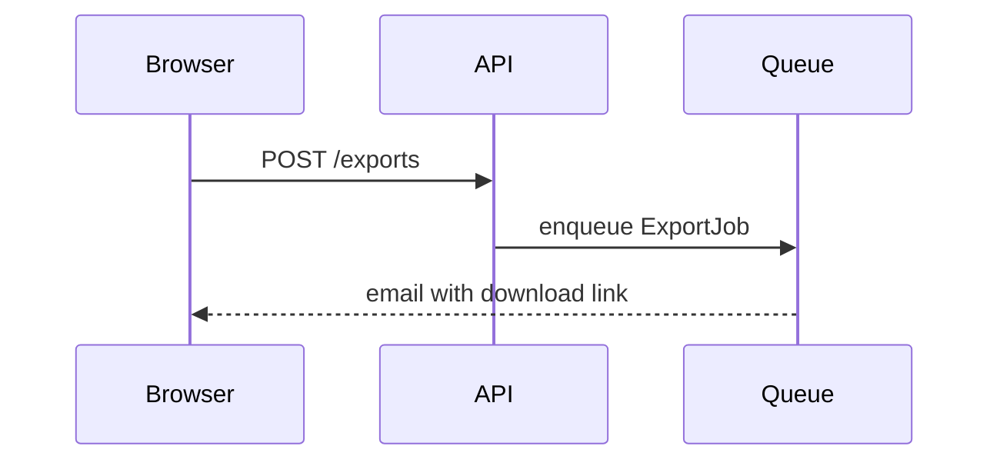

# PR Description

Produce a PR title and body that orient a colleague who knows the codebase but not this branch, in under thirty seconds. Gather intent (the session, plans and specs tied to the branch, commit bodies), read the diff for anything they don't explain, then write.

Return the title and body as output. Only touch the PR itself (`gh pr view`, `gh pr edit`) when the user directs it. When editing in place, leave draft status alone — a ready PR stays ready, a draft stays a draft.

## Title

The title is the short summary of the change. It stands alone in a merge log a year from now, and the body does not repeat its job.

- Imperative mood: "Add", "Fix", "Remove", not "Adds" or "Added".
- Make the scope clear: name the feature, area, or component affected.
- Hint at the why or the problem solved when it fits naturally ("Fix N+1 query on group roster page", "Cache feature flags to reduce boot time").
- Keep it under about 50–72 characters. Sentence case, no trailing period.
- Leave out issue IDs and conventional-commit prefixes unless the repo's history or template uses them.

| Weak                      | Better                                        |
| ------------------------- | --------------------------------------------- |
| `Updates`                 | `Add CSV export to attendance reports`        |
| `Fixed bug with form`     | `Fix duplicate submissions on signup form`    |
| `Refactor stuff for perf` | `Batch roster queries to speed up group page` |

## The body

**A repo's own template wins on structure.** Look for a template (case-insensitive) in `.github/`, the repo root, and `docs/`:

```bash
git ls-files | grep -i 'pull_request_template'
```

When one exists, fill in its sections in its order. Treat HTML comments as instructions: follow them, then remove them. Keep the template's markup as written, and leave checklists as checklists, only checking what is actually true. Then starve it: one sentence per heading, never invent content to fill one. "None." when a section genuinely has nothing to say.

**Default shape: How / Notes / Preview.** With no repo template, assemble the body from these sections — and every section is omitted unless it earns its place. There is no Summary section: the title did that job.

- **How** — verification steps a reviewer can follow, only when verification isn't obvious from the diff: an obscure flow, an edge case, a migration step.
- **Notes** — a sentence each on real alternatives considered, to get ahead of reviewer curiosity; other shared context needed to understand the change.
- **Preview** — screenshots and recordings; a mermaid diagram when a high-level overview or primer saves the reviewer from digging through the diff; `<details>` blocks for specific technical artifacts — preview output, pseudocode, logs, benchmarks. Collapse the artifact, never the reasoning: prose that can't be condensed is cut. Leave a blank line after `<summary>` so the content inside renders.

When a diagram earns its place:

````markdown

````

**Cut on sight**, in any body: file-by-file walkthroughs, "Changes" bullet lists (the commit log, rendered worse), code snippets already in the diff, alternatives that were never real, next steps and future work, "tests pass" claims, and fluff words — simply, just, basically, essentially, currently, leverage, robust, comprehensive, seamlessly.

## Tightening an existing description

Subtraction is the method. Run the passes in order:

1. **Delete whole sections** restating the diff: walkthroughs, "Changes" lists, code from the diff, unfilled checklists.
2. **Delete sentences that exist to sound thorough**: rationale already in the ticket, background the reader has, explanations of how the code works. Keep alternatives to the real ones, one sentence each.
3. **Delete fluff words** and hedges.
4. **Challenge the identity**: cut one more real thing — the piece you're sure has to stay. Reread as the uninformed reader; if they still get it, the cut stays. Restore the one cut that genuinely breaks understanding, and stop there.
5. **Add back, reluctantly.** The test: would a reviewer make a wrong call without it? A risk not visible in the diff, deploy or migration ordering, blast radius larger than the diff suggests, something deliberately left undone that looks like an oversight. One sentence each, in the body.

When the description is someone else's, you are the reducer, not the author: keep their meaning and voice, cut their words, don't replace them with yours.

## Accuracy outranks brevity

Never cut a true, critical fact to hit a length, and never let compression imply something false about scope or risk. If intent isn't recoverable from the session, the artifacts, or the commit bodies, ask one or two targeted questions — a made-up "why" is worse than a short one.
